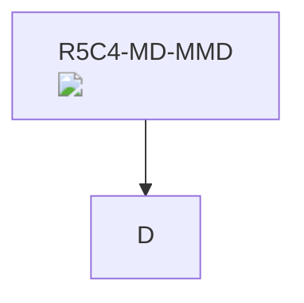

# R5C4-M2
Relative svg: 
Data svg: 



```svg
<svg xmlns="http://www.w3.org/2000/svg" onload="document.title='R5C4-MD-SVGBLOCK'"><text y="20">R5C4-MD-SVGBLOCK</text></svg>
```

```html
<b id="r5c4mdhtml">R5C4-MD-HTMLBLOCK</b>
```
